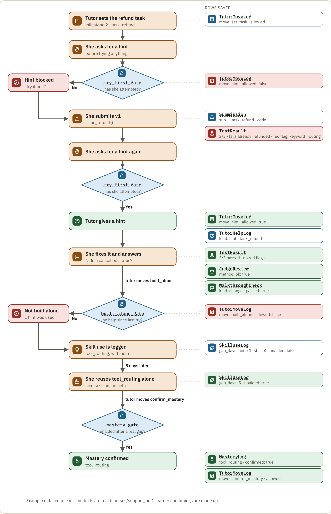

# Courses

**In plain words:** A course is a folder. `course.json` describes the skills and milestones; each milestone has tests and a reference solution. `load_course` checks the folder; `run_reference_solution` proves the tests pass on the reference. Names follow `docs/GLOSSARY.md`.

```
courses/<id>/
  course.json
  milestones/
    01_<id>/ tests/      <- what the learner's work must pass
             reference/  <- a working solution
    02_<id>/ ...
```

Real courses live in the private repo. This repo holds only the sample `support_bot` (two milestones: order-status tool, refund tool).

## course.json

| Field | Meaning |
|---|---|
| `id`, `title`, `subject` | Names the course; `subject` is `code` for now |
| `skills[]` | `id`, `course`, `needs[]` (skill ids), `must_know`, optional `first_learned_session` |
| `milestones[]` | `id`, `order`, `title`, `task`, `submission_file`, `tests[]`, `reference_solution`, `method_questions[]` |
| `milestones[].submission_file` | The file name her code is saved as inside the throwaway test folder (e.g. `support_agent.py`) |
| `milestones[].method_questions[]` | At least one per milestone: `id`, `question`, `wrong_answer` (`yes` or `no`); optional `yes_means`, `no_means` |
| `milestones[].task` | `id`, `milestone` (same as the milestone id), `skill_ids[]`, `brief {why, done_looks_like, you_start_with}` |
| `judge_rubric` | `criteria[]` (at least one) |
| `walkthrough_questions` | Lists of questions for each kind: `explain`, `change`, `fix` (all three required) |

`tests` and `reference_solution` are paths relative to the course folder. Unknown fields are rejected.

## Rules checked on load

| Rule | Error names |
|---|---|
| `course.json` exists and is valid JSON | the file |
| Skill ids are unique; every `needs` id exists | the skill |
| `task.milestone` equals the milestone id; every `skill_ids` entry exists | the milestone |
| Milestone `order` runs 1..n with no gaps | `order` |
| Every walkthrough kind has questions | the kind |
| Every tests file and reference path exists | `milestones.<id>.tests` or `.reference_solution` |

All failures raise `CourseError` with a message naming the field.

## Code

| Call | What it does |
|---|---|
| `load_course(path)` | Reads and validates `<path>/course.json`; returns a `LoadedCourse` (a `Course` that remembers its folder) |
| `LoadedCourse.run_reference_solution()` | For each milestone in order: runs its tests with pytest in a subprocess, with the reference folder on `PYTHONPATH`, no `ANTHROPIC_API_KEY`, 60 s limit. Returns one `TestResult` per milestone (`submission_id` = `reference:<milestone id>`) |

| `LoadedCourse.check_submission(submission, milestone_id, runs=3, timeout=60)` | Copies her code into a throwaway folder as `submission_file`, runs the milestone's tests `runs` times, no API keys in the environment. Returns a `TestResult`; a test that fails in some runs is reported once, as flaky |
| `LoadedCourse.check_method(submission, milestone_id, threshold=0.5)` | Sends the method questions and her code to Jev in one call (her code is never run). P(wrong) = P(yes) if `wrong_answer` is `yes`, else 1 - P(yes); at or above `threshold` it is a `JudgeIssue`. Returns a `JudgeReview`; any Jev failure raises `JevError` |

Needs `TYPESAFE_API_KEY` for the live Jev call; tests stub it. A timeout gives `passed=0, total=0` and a failure line. A healthy course returns `passed == total` for every milestone.

## Add a course

1. Make `courses/<id>/course.json` with the fields above.
2. For each milestone add `milestones/<nn>_<id>/tests/` and `reference/`.
3. Run `load_course("courses/<id>").run_reference_solution()`; every result must be all-pass.
4. Keep it offline: tests need no network and no API key.
5. Real course content goes in the private repo, not here.

## Example: one learner session

One learner on milestone 2 (refund tool): each gate decision and the rows saved. Course ids and texts are real; the learner and timings are made up. Step 2 ships these row shapes; the gates that write them come in steps 5–7 and 13.


