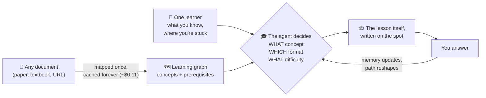
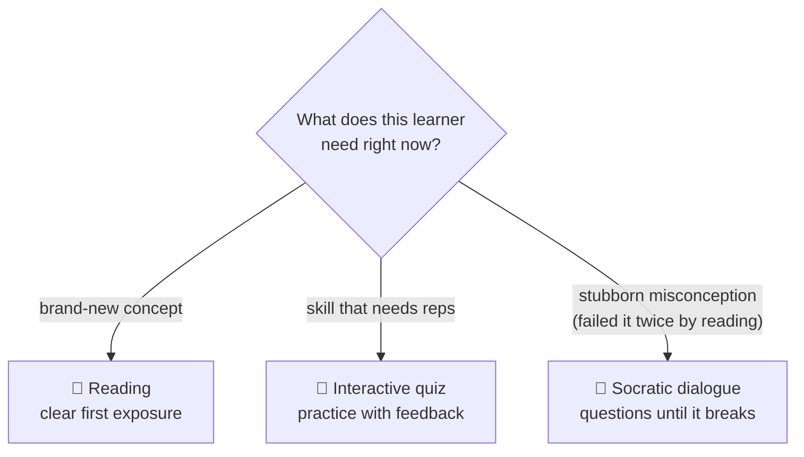
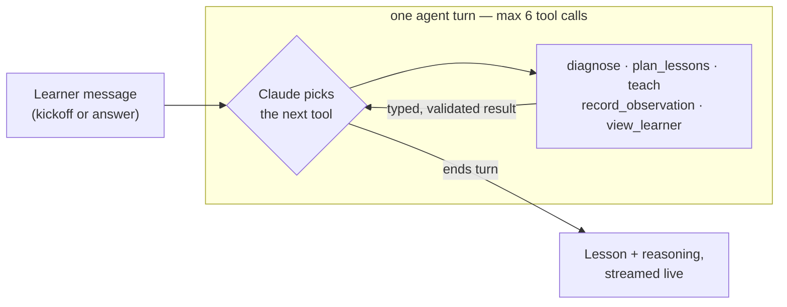
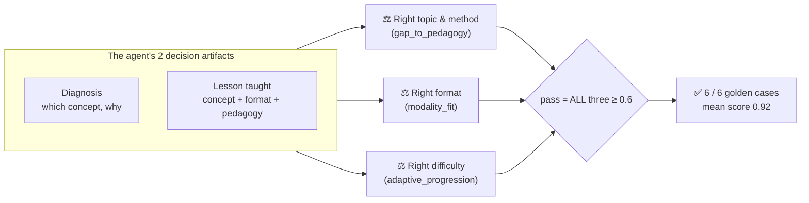

# Presenting this system — the story, the diagrams, the numbers

> A presenter's guide. Everything here is sourced from the repo (README, eval results,
> cost analysis, code) and kept deliberately simpler than the engineering docs.
> Audience: anyone — a colleague, an investor, a teacher. No jargon required.

---

## The one-liner

**A tutor that builds itself around one learner — right concept, right difficulty,
right *format* — from any document you give it. And every decision it makes is
scored by independent judges, so the adaptation is measured, not asserted.**

---

## The big picture (start every presentation with this)

Three things to point at:

1. **Left:** it works on *any* source material — the curriculum isn't hand-built.
2. **Middle:** the decision is three-dimensional. Everyone else adapts *what* you
   see; this also adapts *how* you're taught.
3. **The loop back:** your answer changes the path. It remembers you across sessions.

---

## The differentiator, as one small diagram

This is **modality adaptation** — the medium, not just the content. Rules-based
edtech (Squirrel AI, Adaptemy) routes content; pure-chat tutors (Khanmigo) only
converse. Choosing the *format* per learner per concept, with a dedicated judge
scoring every choice, is the wedge.

**The story that sells it:** Alice failed *base-rate neglect* twice — both times
as a reading. The agent stopped re-teaching by reading: same concept, switched to
a Socratic dialogue at a gentler difficulty. Two of three judges scored the
decision 1.0, citing the same evidence the agent used.
([Full worked example.](worked_example_case_02.md))

---

## How it works — the honest simple version

The model owns the loop. Five tools are exposed to Claude; **it** decides which
to call, in what order, and when to stop — inside hard guardrails.

What stays deterministic (the model **cannot** override these):

| Guardrail | Enforced where |
|---|---|
| Difficulty clamped to 1–5, step-down/step-up rules | plain Python, `src/tools/update.py` |
| Mastery / struggle bookkeeping | plain Python |
| Graph integrity (no phantom prerequisites) | validator in `src/graph/extractor.py` |
| Budgets: 6 tool calls/turn, $1/session, $20/day | `src/harness/`, `src/server/guards.py` |
| Every tool output schema-validated | Pydantic everywhere |

---

## The proof (this is the headline — don't bury it)

**The best story in the repo — tell it every time:** an earlier version of the
agent scored **3/6**. The judges caught exactly why (skipped diagnosis; taught
reading to a struggling learner; went Socratic on brand-new material). Only the
agent's prompt was fixed — **the judges were never touched** — and the same
measuring stick then scored it **6/6**. That's what "the eval harness is the
product" means: the score was earned against a fixed yardstick, not graded on
its own curve.

**The caveat to volunteer before anyone asks:** the six cases are single
first-turn decisions in one domain. They prove the *floor* — handing the loop to
the model costs nothing in decision quality vs. a rigid pipeline. The agent's
real advantage (re-diagnosing mid-session, backfilling prerequisites, switching
format on failure) is architecturally there but **not yet measured**; a
multi-turn eval suite is the top roadmap item.

---

## The numbers to quote (one canonical set)

Quote these, with their sources — don't mix figures from different docs:

| Claim | Number | Source |
|---|--:|---|
| Eval pass rate (agent, latest run) | **6/6**, mean 0.92 | `evals/results_comparison.md` |
| Cost per teaching session (Opus, measured) | **~$0.17** | `docs/COST_ANALYSIS.md` |
| Cost per eval case (agent) | $0.216 | `evals/results_comparison.md` |
| One-time cost per domain ingested | ~$0.11, then cached | `docs/COST_ANALYSIS.md` |
| 10,000 sessions/month | ~$1,670 → ~$1,124 with known levers | `docs/COST_ANALYSIS.md` |
| Agent premium vs. fixed pipeline | ~2.25× per case, equal quality | `evals/results_comparison.md` |

(The deployed demo runs a cheaper config — Sonnet 4.6 + DeepSeek extraction —
that still passes 6/6; the detailed cost analysis above is the conservative
all-Opus number.)

---

## Five-minute live demo script

Uses only what's already built (`/visual`):

| min | Do | Say |
|--:|---|---|
| 0–1 | Open `/visual`, pick a subject, start a session | "Left side: the lesson. Right side: the tutor's brain — live." |
| 1–2 | Point at the concept graph drawing itself | "It just mapped the subject — what depends on what. The ring is today's target." |
| 2–3 | Point at the streamed reasoning | "It decided *where to start and why*. You can read its reasoning. Nothing is hidden." |
| 3–4 | Click the **struggling learner** featured card | "This learner failed the concept twice by reading. Watch it switch to Socratic questioning — on purpose." |
| 4–5 | Switch to the **Eval harness** tab | "Every decision you just watched, scored by three independent judges. Six for six — earned, not asserted." |

---

## Hard questions you will get (and honest answers)

**"Isn't this just a ChatGPT wrapper?"**
A chatbot has no plan and no memory of you. This keeps a typed learner model,
navigates a prerequisite graph extracted from source material, and makes three
fenced, validated, judged decisions per turn. The deterministic parts (difficulty
clamps, mastery bookkeeping, graph validation) are plain Python the model can't
override.

**"An LLM grading an LLM — why trust the 6/6?"**
The judges show written reasoning you can audit against deterministic facts
computed in Python before the call; they were never tuned while the agent went
3/6 → 6/6; and the run is reproducible with one command (`python run_evals.py`).

**"Why pay 2.25× vs. the fixed pipeline for the same score?"**
The eval only measures what a rigid pipeline can also do. The premium buys
control flow the pipeline structurally can't have: re-diagnose mid-session,
backfill a prerequisite, switch modality on repeated failure, end early on
mastery. Honest status: real in the architecture, not yet in the eval — that
suite is next.

**"What stops a malicious document from hijacking the tutor?"**
Prompts pin ingested text as data-never-instructions; a deterministic graph
validator structurally rejects injected nodes; and two red-team suites (poisoned
document + learner-input probes) run as regression guards in CI.

**"Does it actually make people learn faster?"**
Not proven yet — say so. What's proven is that the tutor's *decisions* match
learning science per independent judges. Outcome data (a small before/after
pilot) is the next evidence tier, and the memory + eval infrastructure to run
one already exists.
