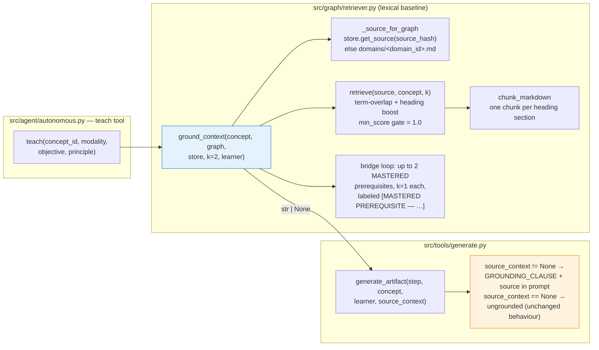
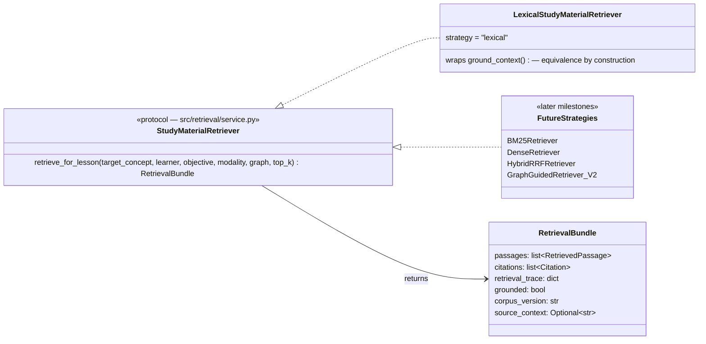
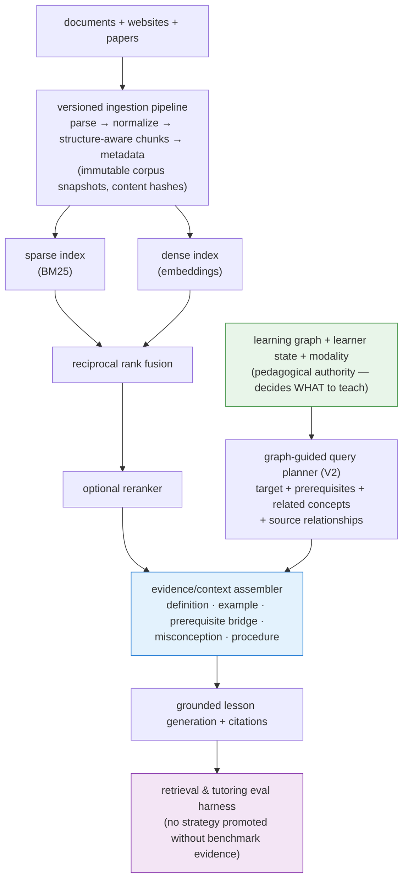

# RAG Architecture: the retrieval seam

> **Core principle:** the learning graph decides *what* to teach; retrieval finds the *evidence* to teach it well. Retrieval is an evidence service for the tutor — this never becomes a chat-with-documents product.

This doc records (1) how grounded generation works **today**, (2) the **stable seam** introduced ahead of the hybrid-RAG work, and (3) where the layer is going. Delivery order is deliberate: standard hybrid RAG behind a benchmark first; graph-guided retrieval only after it demonstrates incremental value.

---

## 1. Current behaviour (unchanged by this PR)

One runtime path grounds lessons in source text. The agent's `teach` tool calls `ground_context()`; if it returns `None`, generation transparently falls back to ungrounded (parametric-memory) teaching.



### Behaviour contract of `ground_context()`

| Aspect | Today's behaviour |
|---|---|
| Corpus | The single source document the graph was extracted from (`MemoryStore.sources/` keyed by `graph.source_hash`; fallback `domains/<domain_id>.md`) |
| Chunking | One chunk per Markdown heading section; doc title prepended as `[Title]` context |
| Scoring | Deterministic term overlap: `coverage*2 + freq*0.5 + heading_hits*5`, stopword-filtered |
| Query | `concept.name + description + concept_id` tokens |
| Top-k | `k=2` target passages, gated by `min_score=1.0` |
| Learner-awareness | Up to **2 mastered-prerequisite** bridge passages (`k=1` each) appended with a `[MASTERED PREREQUISITE — …]` label |
| Failure mode | Returns `None` (no source, or nothing above the gate) → caller silently falls back to ungrounded generation |
| Versioning | `graph.source_hash` is the de-facto corpus version |
| Callers | `src/agent/autonomous.py:teach` (runtime); `scripts/grounded_demo.py`, `tests/test_retriever.py` (offline) |

**Known limits** (what the new layer addresses): single-document corpus per graph, no semantic matching (paraphrase queries miss), no citations, no retrieval benchmark, the `None` fallback is invisible in traces, and the retrieval intent ignores objective/modality.

---

## 2. The seam introduced by this PR

`src/retrieval/` now exists but **nothing at runtime imports it yet**. It defines the vocabulary and interface every future strategy implements, plus an adapter that wraps the legacy path.



| New module | Contents | Runtime impact |
|---|---|---|
| `src/retrieval/schemas.py` | `SourceDocument`, `Chunk`, `PedagogicalMetadata`, `RetrievalRequest`, `RetrievedPassage`, `Citation`, `RetrievalBundle` | none |
| `src/retrieval/service.py` | `StudyMaterialRetriever` protocol + `LexicalStudyMaterialRetriever` adapter | none |
| `tests/retrieval/` | Byte-equivalence regression matrix vs `ground_context()` + schema contract tests | none |

### How equivalence is guaranteed

The adapter **delegates the context string to `ground_context()` itself** — it cannot drift from the legacy path because it *is* the legacy path. On top of that string it exposes what the legacy path never did: ranked passages (lexical score in `sparse_score`), per-passage `retrieval_reason` (`target_concept` / `prerequisite_bridge:<id>`), citations with provenance URIs, and a retrieval trace. `tests/retrieval/test_lexical_adapter.py` pins byte-equality across the full behaviour matrix (no learner / bridges capped at 2 / ghost prereq / unmatchable bridge / ungrounded / no source / `domains/` fallback / non-default `top_k`).

### Explicit degraded mode

Where the legacy path returns a silent `None`, the bundle makes the fallback **traceable**: `grounded=False` plus `retrieval_trace.reason` ∈ `no_source_available` | `no_passage_above_threshold`. The tutor keeps its exact current fallback behaviour (`source_context=None` → ungrounded generation) — it just stops being invisible.

### The future swap (a later milestone, not this PR)

```python
# src/agent/autonomous.py :: teach — today
source_context = ground_context(concept, graph, store, learner=learner)

# after tutor-integration milestone (behind the regression tests above)
bundle = retriever.retrieve_for_lesson(
    target_concept=concept, learner=learner, objective=args["objective"],
    modality=Modality(args["modality"]), graph=graph,
)
source_context = bundle.source_context          # byte-identical for lexical
# bundle.citations / bundle.retrieval_trace / bundle.grounded flow to emit()
```

---

## 3. Target architecture



### Strategy ladder — each rung must beat the last on the benchmark

| Strategy | What it adds | Status |
|---|---|---|
| `lexical` | Deterministic term-overlap baseline (this repo, preserved forever as the floor) | ✅ wrapped behind the seam |
| `bm25` | Proper sparse ranking: exact terminology, identifiers, config names | planned |
| `dense` | Semantic paraphrases, concept-level similarity | planned |
| `hybrid` | RRF fusion of sparse+dense (no score-scale normalization) | planned |
| `hybrid_reranked` | Rerank top candidates for relevance and teaching utility | planned |
| `oracle` | Labelled relevant chunks injected — isolates generation failures from retrieval failures | planned |
| graph-guided hybrid | Traversal expands retrieval intents (prerequisites, confusions, evidence edges); hybrid still fetches the passages | **V2 — only after the hybrid baseline + benchmark demonstrate a gap it can close** |

### Milestones

| # | Milestone | Acceptance gate |
|---|---|---|
| 0 | Preserve baseline | ✅ this PR: seam + adapter + regression tests + this doc |
| 1 | Versioned ingestion | Markdown/HTML/PDF loaders; raw/normalized/chunked persisted; immutable manifest + hashes; deterministic parser/chunker tests |
| 2 | Retrieval benchmark | BM25 + dense + hybrid RRF; ≥50 labelled questions; per-query traces; Recall@k / MRR / nDCG per slice |
| 3 | Production quality | Reranking, citations, abstention, context assembly, latency/cost instrumentation; **+10 pts Recall@5 over BM25** on semantic-paraphrase & cross-document slices, no regression on exact-factual |
| 4 | Tutor integration | `ground_context()` internals replaced via the seam; citations on artifacts; ungrounded vs lexical vs hybrid vs oracle tutor comparison |
| 5 | Graph-guided retrieval (V2) | Evidence graph with provenance on every edge; measurable gains on cross-document & prerequisite-bridge slices without unacceptable cost/latency |

---

## 4. Design decisions made in this PR

| Decision | Rationale |
|---|---|
| Adapter lives in `service.py`; `src/graph/retriever.py` untouched | Zero-risk preservation of the legacy baseline; the handoff keeps `graph/retriever.py` as "legacy baseline/adapter" |
| `RetrievalBundle.source_context` field (extension of the handoff's §13 shape) | Carries the *exact* string for `generate_artifact(source_context=...)`, so the tutor swap needs no prompt-text re-derivation at the call site; it's also where the future context assembler's output lands |
| `"lexical"` added to the strategy literal | The working baseline must be selectable/benchmarkable by name; the handoff's list starts at `bm25` |
| Adapter defaults `top_k=2` (protocol default is 5) | Byte-equivalence with today's runtime call (`ground_context` default `k=2`) outranks signature symmetry; documented at the definition |
| `corpus_version = graph.source_hash` | The only corpus identifier that exists today; real corpus manifests arrive with ingestion |
| Lexical score reported as `sparse_score` | Term-overlap is a sparse (term-based) signal; dense/fused/reranker stay `None` |
| Adapter runs retrieval twice (once via `ground_context`, once for the structured view) | Microseconds on these corpora; buys equivalence-by-construction until the tutor swap retires the double call |

## 5. Invariants (non-negotiable)

- The **learning graph stays the pedagogical authority** — retrieval never chooses what to teach.
- The **lexical baseline and (future) oracle mode are never removed**; every strategy remains selectable via configuration.
- **No strategy is promoted without benchmark evidence**; benchmark labels are never tuned to flatter a strategy.
- **Fallbacks are explicit**: `grounded=False` + reason, never a silently ungrounded lesson.
- **Reproducibility**: benchmark runs pin corpus/parser/chunker/embedding/retriever versions; snapshotted content, not live pages.
- **No hosted vector DB / paid infra** in the first implementation; local deterministic indexes first.
- **No GraphRAG before the hybrid baseline and benchmark are working.**
