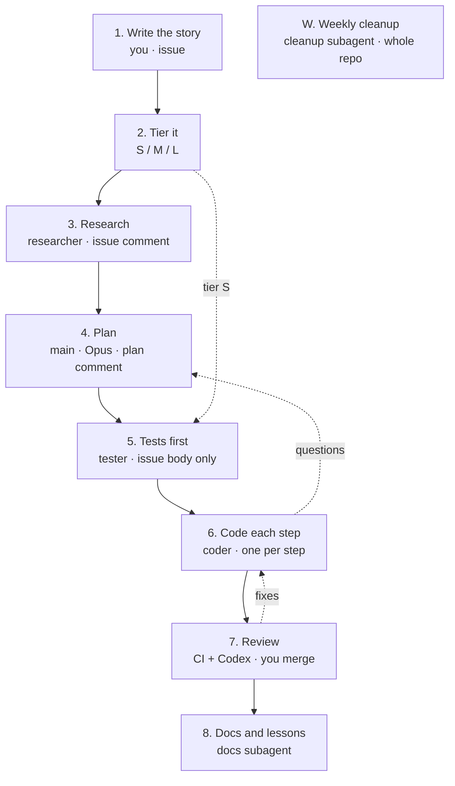
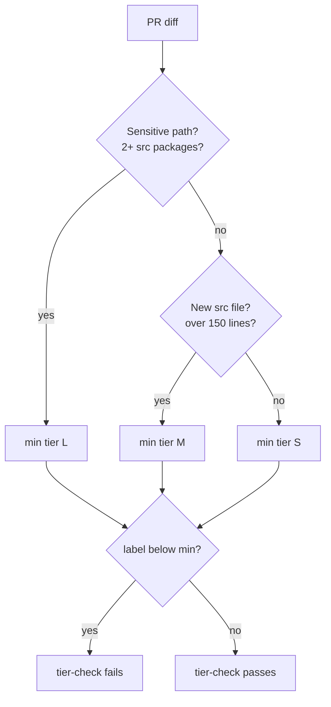

# SDLC workflow

One long-lived planner keeps the big picture; every other job is a subagent that
starts with a clean context and hands off through GitHub, not chat.
Interactive version: [`SDLC_PLAYBOOK.html`](SDLC_PLAYBOOK.html).



## Tiers

| Tier | Any of these makes it this tier | Stages | Merge |
|------|-----------|--------|-------|
| L | Touches `.github/sensitive-paths.txt` · more than one `src/` package · new module or data model change | All + you approve the plan before tests | On your instruction, after Claude checks CI + Codex |
| M | New behaviour a user can notice · new `src/` file · over 150 changed lines | All | On your instruction, after Claude checks CI + Codex |
| S | None of the above | 5, 6, 7 | Auto-merge once Codex threads are resolved and checks are green |



The check (`.github/workflows/tier.yml` → `.github/scripts/check_tier.py`) sets a
floor from the diff. The whole workflow runs from the base branch
(`pull_request_target`), and the PR's commits are only diffed, never run, so a PR
cannot loosen its own grading. Edits to the workflow, checker or rules take
effect only after they merge. It also fails while a PR has the `hold` label,
or while auto-merge is on for an M or L PR. Behaviour changes it cannot see are judgement: the planner
raises the tier, never lowers it.

## Where state lives

| State | Lives in |
|-------|----------|
| Spec | Issue body (`story` template) |
| Research | Issue comment |
| Plan | Issue comment |
| Current stage | Issue label `stage:*` |
| Tests and code | Branch commits, pushed after every step |
| Review | PR comments |
| Tech debt | Issues labelled `tech` |
| Lessons | CLAUDE.md |

## Files

| Path | Role |
|------|------|
| `.claude/agents/researcher.md` | Read-only code map → issue comment |
| `.claude/agents/tester.md` | Red tests from the issue body, edits `tests/` only |
| `.claude/agents/coder.md` | One plan step, never edits `tests/` |
| `.claude/agents/docs.md` | Docs from `git diff main...HEAD` |
| `.claude/agents/cleanup.md` | Weekly bloat removal, no behaviour change |
| `.claude/commands/{research,test,code}.md` | `/research <n>`, `/test <n>`, `/code <n> <step>` |
| `.github/ISSUE_TEMPLATE/story.yml` | Story shape: who, action, outcome, criteria, tier |
| `.github/workflows/ci.yml` | ruff + pytest — make it a required check |

## Weekly cleanup

```bash
git switch -c cleanup/$(date +%G-w%V)
ruff check . --select F401,F841,ERA001 --fix
vulture src/ --min-confidence 80
npx jscpd src/
# then: "Use the cleanup subagent on the findings and open tech issues."
pytest tests/
```

## One-time setup (manual)

- Labels: `stage:research`, `stage:plan`, `stage:tests`, `stage:code`, `stage:review`,
  `tier:S`, `tier:M`, `tier:L`, `story`, `tech`, `cleanup`, `hold` (blocks any merge while applied)
  (`for l in research plan tests code review; do gh label create "stage:$l"; done`).
- Branch protection on `main`: require the `test (py3.10/3.11/3.12)` and `tier-check`
  checks, and "Require conversation resolution before merging" (so Codex threads block).
- Settings → General → "Allow auto-merge" (needed for tier S).
- Enable the Codex GitHub reviewer for `@codex review`.
